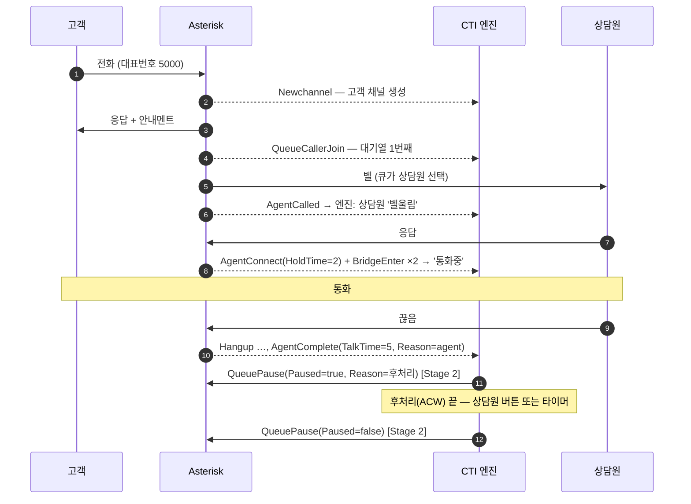

# 01. 시스템 아키텍처

## 1. 무엇을 만드나

실무 IPCC 스택(오픈소스 Asterisk, Rust에서 Go로 옮기는 중인 핵심 엔진, Node.js, MySQL)을 작게 재현한 **미니 IPCC**다.

IPCC 엔진이 하는 일을 한 문장으로 줄이면 다음과 같다.

> Asterisk가 쏟아내는 이벤트를 받아 콜·상담원·큐 상태를 **정확하게** 유지하고,
> 그 상태를 상담원 화면·현황판·통계·고객사 시스템으로 흘려보낸다.

어려운 부분은 "정확하게"다. 콜 하나에 채널이 여러 개 생기고, 연결은 끊기고, 이벤트는 예상과 다른 순서로 오고,
고객사 API는 느리다. 이 프로젝트의 단계(Stage)는 이 어려움을 하나씩 겪어 보도록 짜여 있다.

## 2. 구성도

```text
소프트폰(Linphone) · 브라우저(WebRTC, Stage 3) · SIPp(자동 테스트)
        │ SIP / RTP
        ▼
Asterisk 22 LTS (Docker, asterisk/)
  PJSIP · 다이얼플랜 · Queue(ACD) · MixMonitor · ChanSpy
        │ AMI :5038      이벤트 수신, 액션(콜 제어)            ← 엔진이 접속
        │ FastAGI :4573  ARS 로직을 엔진에 물어봄 (Stage 5)    ← Asterisk가 접속
        ▼
Go CTI 엔진 (engine/)
  ami     접속·재접속·ActionID 매칭·녹화               Stage 1 ✅
  state   콜/상담원/큐 상태머신, 재동기화               Stage 2
  ars     FastAGI 서버                                Stage 5
        │ Redis pub/sub (Stage 3)          │ MySQL (Stage 4)
        ▼                                  ▼
Node.js 게이트웨이 (Stage 3)               콜 이력 · 상담원 상태 이력 · 15분 통계
  WebSocket ──▶ 상담원 툴바 · 슈퍼바이저 현황판
  REST/웹훅 ──▶ Mock CRM (고객사 연동, Stage 6)
```

Node.js를 회사에서 정확히 어디에 쓰는지는 아직 모른다. 가장 흔한 자리인 웹·API 계층에 두었다.

## 3. 구성요소와 책임

경계를 분명히 해 두면 장애가 났을 때 어디를 봐야 할지 바로 정해진다.

| 구성요소 | 맡는 일 | 맡지 않는 일 | 위치 | Stage |
|---|---|---|---|---|
| Asterisk | SIP 시그널링, 음성(RTP) 중계, 다이얼플랜, 큐 분배, 녹취 | 상담원 업무 상태(이석·후처리) 판단, 통계 | `asterisk/` | 0 ✅ |
| AMI 클라이언트 | 접속·로그인·재접속, 액션 송신과 응답 매칭, 이벤트 전달, 원본 녹화 | 이벤트의 의미 해석 | `engine/ami` | 1 ✅ |
| 상태머신 | 콜·상담원·큐 상태의 단일 기준(source of truth), 재동기화 | 화면 표시, 장기 통계 | `engine/state` (예정) | 2 |
| 게이트웨이 | WebSocket(상담원·현황판), REST, 웹훅 | 콜 제어 판단 (엔진에 위임) | `gateway/` (예정) | 3, 6 |
| Redis | 엔진 → 게이트웨이 이벤트 전달, 실시간 상태 캐시 | 영구 저장 | compose (예정) | 3 |
| MySQL | 콜 이력, 상담원 상태 이력, 15분 집계 | 실시간 상태 | compose (예정) | 4 |
| ARS | 멘트, DTMF 메뉴, 고객 조회, 큐 선택 | 상담원 상태 | `engine/ars` (예정) | 5 |
| Mock CRM | 고객사 시스템 흉내 (REST, 고정길이 전문) | | (예정) | 5, 6 |

## 4. 포트

| 포트 | 프로토콜 | 방향 | 용도 | Mac에 공개 |
|---|---|---|---|---|
| 5060/udp | SIP | 소프트폰 → Asterisk | 등록, 호 제어 | 127.0.0.1 (LAN 모드: 0.0.0.0) |
| 10000-10099/udp | RTP/RTCP | 양방향 | 음성 (동시 약 25통화) | 127.0.0.1 (LAN 모드: 0.0.0.0) |
| 5038/tcp | AMI | 엔진 → Asterisk | 이벤트 수신, 액션 | 127.0.0.1 |
| 8088/tcp | HTTP/WS | 브라우저 → Asterisk | WebRTC(WebSocket), ARI | 127.0.0.1 |
| 4573/tcp | FastAGI | Asterisk → 엔진(Mac) | ARS 로직 (Stage 5) | 엔진이 Mac에서 연다 |

Mac에서 컨테이너로 들어온 접속은 컨테이너 안에서 Docker 게이트웨이 주소(실측 `172.23.0.1`)에서 온 것으로 보인다.
NAT 설정(04 문서)과 AMI 접속 허용 목록(`manager.conf`의 permit)은 이 사실을 전제로 짰다.

## 5. 콜 한 건의 흐름

실제 녹화(`engine/testdata/sim-normal-and-abandon.log`)에서 확인한 순서다. 이벤트 세부는 [05-ami.md](05-ami.md) 참고.



Asterisk는 **B2BUA**(양쪽 통화를 각각 끝단으로 처리하는 중계기)라서 고객 쪽 구간과 상담원 쪽 구간이 별개의 채널이다.
"콜 하나 = 채널 여러 개"이고, 이것들을 하나로 묶는 열쇠가 `Linkedid`다.

## 6. 설계 원칙

모든 Stage에 적용한다. 각 원칙의 배경은 [09-decisions.md](09-decisions.md)에 있다.

1. **상담원 업무 상태의 기준은 엔진이다.** 이석·후처리는 Asterisk에 없는 개념이다.
   Asterisk의 디바이스 상태(단말이 통화 중인가)와 엔진의 상담원 상태(업무상 무엇을 하는가)는 다르다.
   엔진이 판단하고 Asterisk에는 `QueueAdd`/`QueuePause`로 반영만 한다.
2. **상태는 고루틴 하나가 소유한다(액터 패턴).** 이벤트·명령·타이머를 한 채널로 받아 순서대로 처리한다.
   락이 거의 필요 없고, 같은 입력이면 같은 결과가 나온다(테스트·포팅이 쉬워진다).
3. **AMI 읽기 루프는 절대 막지 않는다.** DB 쓰기, 고객사 API 호출 같은 느린 일은 별도 워커에서 한다.
   읽기 루프가 막히면 Asterisk가 그 세션을 느린 클라이언트로 보고 끊는다(`manager.conf`의 `writetimeout`).
4. **연결은 끊긴다고 가정한다.** 재접속 직후 스냅샷(`CoreShowChannels`, `QueueStatus`)으로 상태를 다시 맞추고,
   이벤트 처리는 같은 이벤트를 두 번 받아도 결과가 같게(멱등) 만든다.
5. **모든 로그에 콜 ID(Linkedid)를 남긴다.** 장애 분석은 결국 "이 콜에 무슨 일이 있었나"를
   SIP 트레이스, AMI 녹화, 엔진 로그, DB에서 같은 ID로 꿰어 보는 일이다.
6. **원본 이벤트를 녹화한다.** replay 테스트, Rust↔Go 차분 테스트, 장애 재현의 재료가 된다.
7. **통계 정의는 설정값이다.** 포기호·서비스레벨 기준은 고객사마다 다르다. 코드에 박지 않는다.

## 7. 폴더 구조

```text
IPCC_Playground/
├── Makefile                 자주 쓰는 명령 (make로 목록 보기)
├── docker-compose.yml       Asterisk (Stage 3~4에 redis, mysql 추가 예정)
├── .github/workflows/       CI: make test + lint, make e2e
├── asterisk/
│   ├── Dockerfile           Asterisk 22.11 소스 빌드 + sngrep/tcpdump/sipp
│   ├── entrypoint.sh        NAT 설정 생성(EXTERNAL_IP, 컨테이너 IP), 시간대 설정, 실행
│   └── conf/                설정 파일 (컨테이너의 /etc/asterisk에 읽기 전용으로 마운트)
├── engine/                  Go CTI 엔진 (모듈 ipcc/engine)
│   ├── ami/                 AMI 프로토콜·클라이언트 (Stage 1)
│   ├── rtpcheck/            최소 SIP UA: 에코로 RTP 왕복을 세는 음성 경로 검사
│   ├── cmd/amicli/          학습용 CLI: watch, action, replay, agent, sim-call
│   ├── cmd/rtpcheck/        make rtp-check
│   ├── e2e/                 실제 Asterisk로 콜 흐름 전체 검증 (make e2e)
│   └── testdata/            replay 테스트용 AMI 녹화 (번호를 가린 것만)
├── tests/sipp/              SIPp 시나리오 (등록, 고객 발신, 상담원 응답)
├── docs/                    이 문서들
├── data/                    (git 제외) Asterisk 로그·CDR·queue_log·녹음
└── recordings/              (git 제외) amicli watch가 녹화한 AMI 원본
```

## 8. 현재 상태

Stage 0(환경)과 Stage 1(AMI 클라이언트)의 레퍼런스 구현이 있다. 다음 할 일은 [02-roadmap.md](02-roadmap.md)에 있다.
