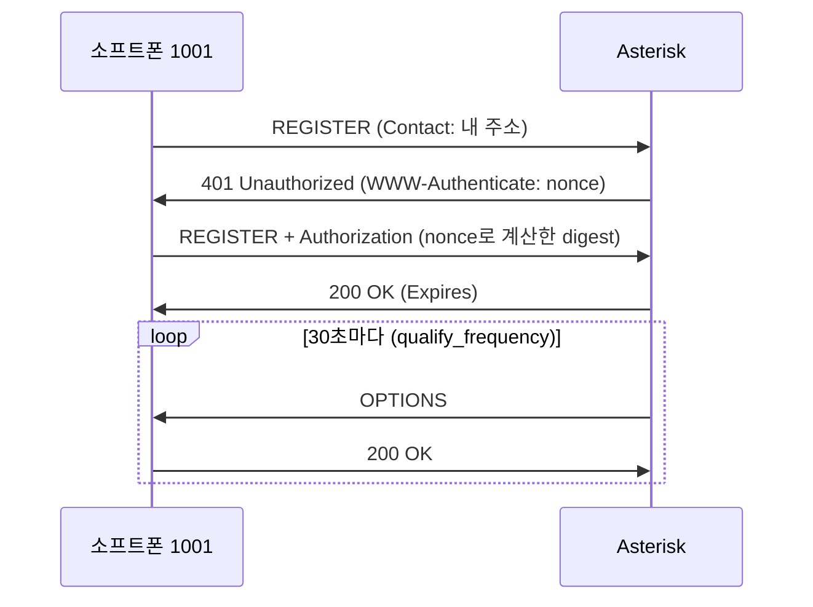
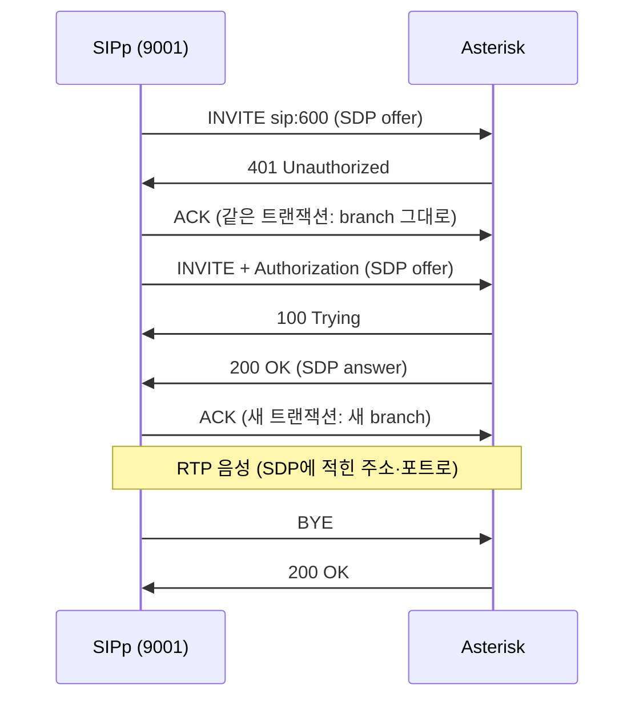

# 04. SIP · SDP · RTP — 그리고 "소리가 안 들려요"

IPCC 엔진은 SIP를 직접 다루지 않는다(그건 Asterisk 몫이다). 그래도 장애 신고의 상당수는 SIP·RTP 문제라서,
엔진 개발자도 SIP 트레이스를 읽고 "엔진 문제인지 교환기 문제인지"를 가를 수 있어야 한다.

> RFC 3261을 처음부터 정독하기보다 `make sngrep`으로 실제 콜 100개를 보는 편이 빠르다.
> 이 문서는 그 100개를 볼 때 무엇을 봐야 하는지 정리한 것이다.

## 1. SIP 한 장 요약

- **텍스트 프로토콜**이다. HTTP처럼 요청(메서드)과 응답(상태 코드)이 있다.
- **트랜잭션** = 요청 하나와 그 응답들. Via 헤더의 `branch` 값으로 구분한다.
- **다이얼로그** = 통화 하나. `Call-ID` + From의 tag + To의 tag로 구분한다.
- 응답 코드: 1xx 진행 중, 2xx 성공, 3xx 리다이렉트, 4xx 요청 문제, 5xx 서버 문제, 6xx 전역 실패.
- Asterisk는 **B2BUA**다. 고객 ↔ Asterisk, Asterisk ↔ 상담원이 서로 다른 다이얼로그다.
  그래서 콜 하나에 채널(구간)이 둘 이상 생긴다. → AMI 이벤트가 채널마다 따로 나온다 (05 문서)

## 2. 등록 (REGISTER)



- 처음 401은 **실패가 아니라 정상 절차**다. 비밀번호를 직접 보내지 않고, 서버가 준 nonce로 계산한 값을 보낸다.
- 비밀번호가 틀리면 401이 반복되거나 403이 온다.
- `rewrite_contact = yes`라서 Asterisk는 소프트폰이 적어 보낸 Contact 대신 **패킷이 실제로 온 주소**를 기록한다.
  확인: `make rx c="pjsip show contacts"`
- OPTIONS(qualify)는 단말이 살아있는지 확인하는 동시에 NAT 매핑이 만료되지 않게 지켜 준다.

## 3. 통화 (INVITE ~ BYE)

실제로 캡처한 흐름이다 (`make sip-echo`: SIPp 9001 → 600 에코, `pjsip set logger on`).



Asterisk가 보낸 401 (실제 메시지):

```text
SIP/2.0 401 Unauthorized
Via: SIP/2.0/UDP 127.0.0.1:5070;rport=5070;received=127.0.0.1;branch=z9hG4bK-75-1-0
Call-ID: 1-75@127.0.0.1
From: "SIPp" <sip:9001@127.0.0.1>;tag=75SIPpTag001
To: <sip:600@127.0.0.1>;tag=z9hG4bK-75-1-0
CSeq: 1 INVITE
WWW-Authenticate: Digest realm="asterisk",nonce="1792123590/c3bc…",opaque="323d…",algorithm=MD5,qop="auth"
Server: IPCC-Playground
Content-Length:  0
```

`Via`의 `rport=5070;received=127.0.0.1`은 "네가 실제로 보낸 주소·포트는 이것"이라는 표시다(RFC 3581, `force_rport`).

자주 보는 응답 코드:

| 코드 | 뜻 | 흔한 원인 |
|---|---|---|
| 100 Trying | 받았다, 처리 중 | (정상) |
| 180 Ringing / 183 Session Progress | 벨이 울린다 / 조기 미디어(링백·안내멘트) | (정상) |
| 401 / 407 | 인증 필요 | (정상 절차) 반복되면 비밀번호 확인 |
| 403 Forbidden | 거부 | 인증 실패, ACL |
| 404 Not Found | 그런 번호 없음 | 다이얼플랜 context에 해당 exten이 없음 |
| 480 Temporarily Unavailable | 지금 받을 수 없음 | 상대 단말이 등록되지 않음 |
| 486 Busy Here | 통화 중 | |
| 487 Request Terminated | 요청이 취소됨 | 벨이 울리는 중 발신자가 끊음(CANCEL) |
| 488 Not Acceptable Here | 미디어 협상 실패 | 공통 코덱이 없음 (`allow` 확인) |
| 408 Request Timeout | 응답 없음 | 네트워크·NAT, 상대가 꺼짐 |

## 4. SDP 읽는 법

Asterisk가 200 OK에 실어 보낸 SDP answer (실제):

```text
v=0
o=- 1 4 IN IP4 127.0.0.1
s=Asterisk
c=IN IP4 127.0.0.1                 ← 음성을 '여기로' 보내라 (가장 중요)
t=0 0
m=audio 10052 RTP/AVP 0 101        ← 포트 10052로, 페이로드 0(PCMU)과 101(DTMF)
a=rtpmap:0 PCMU/8000               ← 0번 = G.711 μ-law, 8kHz
a=rtpmap:101 telephone-event/8000  ← 101번 = DTMF 이벤트 (RFC 4733)
a=fmtp:101 0-16                    ← 0~9, *, #, A~D, flash
a=ptime:20                         ← 패킷 하나에 20ms
a=maxptime:140
a=sendrecv                         ← 양방향 (보류 중이면 sendonly/inactive)
```

- **offer/answer**: INVITE의 SDP가 제안(offer), 200 OK의 SDP가 답(answer)이다. answer에 남은 코덱이 실제로 쓰인다.
- 포트 10052는 `rtp.conf`의 범위(10000-10099) 안에서 Asterisk가 고른 것이다.
- 여기서 `c=`가 127.0.0.1인 이유: SIPp가 컨테이너 안(127.0.0.1)에서 걸었고, 127.0.0.1은 `local_net`이라서
  원래 주소를 적었다. Mac에서 걸면 `external_media_address` 값이 적힌다 (6절, `make rtp-check`로 확인).

## 5. RTP

- G.711은 8,000 샘플/초 × 8비트 = 64kbps다. 20ms마다 160바이트씩, 초당 50패킷을 보낸다.
  IP/UDP/RTP 헤더(40바이트)를 더하면 한 방향에 약 80kbps다.
- RTCP(품질 통계)는 보통 RTP 포트 + 1을 쓴다. 그래서 통화 구간 하나에 포트 2개가 필요하다.
- Asterisk를 거치는 2자 통화는 구간이 2개라 포트 4개를 쓴다. 10000-10099 범위면 동시에 약 25통화다.
- `strictrtp = yes`(기본값): 협상한 상대가 아닌 곳에서 온 RTP는 버린다.

**DTMF**가 안 먹히면(ARS에서 번호를 눌러도 반응이 없으면) 양쪽의 DTMF 방식이 맞는지 본다.
이 프로젝트는 `dtmf_mode = rfc4733`이고 SDP에 `telephone-event`가 있어야 한다.

## 6. NAT와 "연결은 되는데 소리가 안 들려요"

### 원리

SIP 메시지와 SDP 안에 **IP 주소가 글자로 적혀 있다.** NAT 뒤의 단말이나 컨테이너는 자기 사설 IP를 적는데,
상대는 그 주소로 갈 수 없다. 시그널링(SIP)은 다른 경로로 어떻게든 오가니 "연결"은 되지만,
음성(RTP)은 SDP의 `c=` 주소로 보내지므로 엉뚱한 곳으로 간다. → **단방향 음성 또는 무음.**

### 이 프로젝트의 구성 (Mac Docker Desktop)

```text
Linphone(Mac) ──▶ 127.0.0.1:5060 ──▶ [Docker Desktop 포트포워딩] ──▶ 컨테이너 172.23.0.2:5060
                                                       컨테이너에서는 출발지가 172.23.0.1로 보인다
```

- Mac은 컨테이너 IP(172.x)로 직접 갈 수 없다. Asterisk가 SDP에 `c=IN IP4 172.23.0.2`라고 적으면 음성이 안 간다.
  그래서 바깥 상대에게는 `external_media_address`/`external_signaling_address`(= `EXTERNAL_IP`)를 대신 적게 한다.
- Asterisk가 주소를 바꿔 적는 조건은 **두 가지**다 (컨테이너 안의 `res_pjsip_nat.c`, `res_pjsip_sdp_rtp.c`에서 확인).
  1. 받는 쪽이 `local_net` **밖**이어야 한다. Mac에서 온 패킷은 Docker 게이트웨이(172.23.0.1)에서 온 것으로 보인다.
  2. 자기 SDP 주소(컨테이너 IP)는 `local_net` **안**이어야 한다. 소스 주석 그대로 "내 주소가 사설일 때만 바꾼다".
- 그래서 `local_net`에는 **컨테이너 자신(`/32`)과 127.0.0.1만** 넣는다. 컨테이너 IP는 `entrypoint.sh`가 시작할 때마다 찾아 넣는다.
  게이트웨이를 포함하는 대역(172.16.0.0/12 등)을 넣으면 조건 1이 깨지고, 127.0.0.1만 넣으면 조건 2가 깨진다.
- 처음 설정은 127.0.0.1만 넣어서 조건 2가 깨져 있었다. 컨테이너 안에서 도는 SIPp 테스트는 통과해서 몰랐고,
  Mac에서 실제로 걸어 보는 `make rtp-check`가 SDP의 `c=172.23.0.2`를 보여 주며 잡았다 (D-014).
- `EXTERNAL_IP`는 `make up`이면 127.0.0.1, `make up-lan`이면 Mac의 LAN IP다. 생성된 실제 설정은
  `make rx c="pjsip show transport transport-udp"`로 확인한다.
- RTP 포트 범위는 `rtp.conf`와 `docker-compose.yml`의 포트 공개 범위가 **반드시 같아야 한다.**

`make rtp-check`의 정상 출력 (Mac에서 실행):

```text
SIP  우리 127.0.0.1:56017 → 서버 127.0.0.1:5060 (9001 → 602)
SDP  Asterisk가 알려 준 음성 주소 127.0.0.1:10008 (PCMU/8000), 우리 음성 주소 127.0.0.1:60406
RTP  보냄 100 / 받음 96, 첫 에코까지 81ms
✓ 양방향 음성 경로 정상
```

처음 몇 개가 돌아오지 않는 것은 정상이다. `strictrtp`가 상대 주소를 배우는 동안(probation) 버린다.

PJSIP의 NAT 관련 옵션:

| 옵션 | 위치 | 역할 |
|---|---|---|
| `local_net` | transport | 받는 쪽이 이 대역 밖이고 자기 주소가 이 대역 안일 때만 external 주소로 바꿔 적는다 |
| `external_media_address` | transport | SDP `c=`에 적을 주소 |
| `external_signaling_address` | transport | Contact/Via에 적을 주소 |
| `rtp_symmetric` | endpoint | 실제로 RTP가 온 주소로 RTP를 보낸다 (comedia) |
| `force_rport` | endpoint | SIP 응답을 실제 출발지 포트로 보낸다 |
| `rewrite_contact` | endpoint | 등록 주소를 실제 출발지로 고쳐 기록한다 |
| `direct_media = no` | endpoint | 음성이 항상 Asterisk를 거치게 한다 (녹취·감청에도 필요) |

### 진단 순서

0. **`make rtp-check`로 서버 쪽부터 확인한다.** 통과하면 Asterisk·Docker·NAT 설정은 정상이고, 소프트폰 설정을 보면 된다.
1. **방향을 확인한다.** "내 목소리가 안 간다"인지 "상대 목소리가 안 온다"인지. 방향이 곧 틀린 주소의 위치다.
2. **`make sngrep`으로 INVITE와 200 OK의 SDP를 본다.** `c=` 주소가 상대 입장에서 갈 수 있는 주소인가?
   (사설 IP·컨테이너 IP가 적혀 있으면 거의 확정)
3. **RTP가 실제로 오가는지 본다.** `make rx c="rtp set debug on"` 후 통화 → `make logs`에
   `Got RTP packet from …` / `Sent RTP packet to …`가 양쪽 다 찍히는지. 확인 뒤 `rtp set debug off`.
4. **포트를 본다.** 협상된 RTP 포트가 공개 범위(10000-10099) 안인가?
5. **코덱을 본다.** 488이 오거나 answer에 코덱이 하나도 안 남았으면 `allow` 설정 문제다.
6. **방화벽·VPN**: Mac의 방화벽, 회사 VPN이 UDP를 막지 않는지.

> 실습: `pjsip_transport.conf.tmpl`에서 `local_net = @CONTAINER_IP@/32` 줄을 지우고 `make restart` →
> `make rtp-check`가 실패하고 SDP 주소가 컨테이너 IP로 바뀌는 것을 본다 → 소프트폰으로도 재현 → 되돌린다.

## 7. 실습 도구

| 도구 | 명령 | 용도 |
|---|---|---|
| sngrep | `make sngrep` | SIP 흐름을 래더 다이어그램으로. 콜을 고르고 Enter, 도움말 F1, 종료 q |
| PJSIP 로거 | `make rx c="pjsip set logger on"` → `make logs` | SIP 메시지 원문을 Asterisk 로그로 |
| RTP 디버그 | `make rx c="rtp set debug on"` | RTP 송수신 확인 (양이 많으니 짧게 켠다) |
| tcpdump | `make pcap` → `data/asterisk/log/capture.pcap` | Wireshark: Telephony › VoIP Calls › Play Streams |
| SIPp | `make sip-register`, `make sip-echo`, `make sip-queue`, `make sip-agent-call` | 자동 테스트. 시나리오는 `tests/sipp/` |
| rtpcheck | `make rtp-check` | Mac에서 602(에코)로 걸어 RTP 왕복을 센다. 음성 경로 자동 검사 |

`engine/rtpcheck`는 **SIP를 직접 말해 보는 최소 구현**이기도 하다. 3절의 흐름(INVITE → 401 → Digest 인증 → 200 → ACK
→ RTP → BYE)과 4절의 SDP, 5절의 RTP 헤더가 주석을 포함해 560줄 정도로 들어 있다. 트레이스와 나란히 놓고 읽어 볼 만하다.
