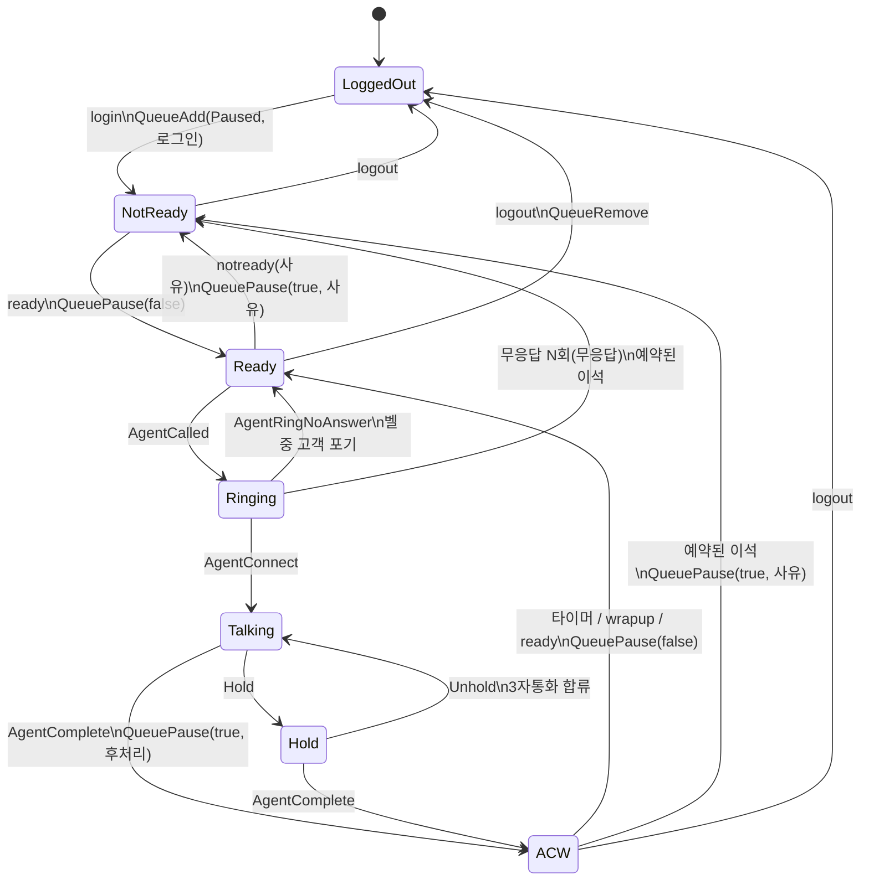

# 06. 상태 모델 — 콜 · 상담원 · 큐 (Stage 2)

> **상태: 구현됨.** Rust 레거시 `legacy-rust/` → Go 포팅 `engine/state/` → 실시간 엔진 `engine/live/`, `bin/engine`.
> 이 문서의 전이표는 `engine/state/testdata/`의 시나리오 녹화 11개와 Stage 1 녹화 2개로 확인했다.
> **근거** 칸에는 그 행을 보여 주는 녹화나 테스트를 적었고, **?** 는 아직 녹화로 확인하지 않은 가설이다.

## 1. 목표와 범위

AMI 이벤트(05 문서)와 상담원 명령(대기·이석 버튼 등)을 받아서 다음을 **정확하게** 유지한다.

- 지금 어떤 콜이 있고 각 콜이 어디까지 왔는가 (대기 / 벨 / 통화 / 보류 / 전환 / 종료)
- 상담원마다 지금 무엇을 하고 있는가, 왜 그런가 (이석 사유)
- 상담원 상태의 기준은 엔진이다. Asterisk의 큐 멤버(Paused)는 엔진이 `QueuePause` 등으로 맞춘다 (D-008)

범위 밖: 화면 표시와 명령 API(Stage 3), 이력 저장과 통계(Stage 4). 상태머신은 이들에게 **출력 줄**만 내보낸다.

## 2. 순수한 코어 + 얇은 껍데기

```go
e := state.New(state.DefaultPolicy())
out := e.Apply(ts, in)   // 입력 하나 → 출력 줄들 (상태 변화, 보낼 액션, 경고)
out  = e.Advance(ts)     // 입력 없이 시간만 흘린다 (실시간 엔진의 시계)
out  = e.Flush()         // 남은 타이머를 모두 처리한다 (녹화 재생의 끝)
line := e.Snapshot()     // 지금 상태 한 줄
```

- **입력** 4종: AMI 이벤트, 채널 스냅샷(CoreShowChannels), 큐 스냅샷(QueueStatus), 상담원 명령.
- **출력** 줄: `agent`(상담원 상태 변화), `call`(콜 상태 변화), `call_end`(콜 결과), `action`(Asterisk에 보낼 액션), `warn`(보정·이상).
- 코어는 I/O가 없고 **시간도 직접 읽지 않는다.** 입력에 붙은 시각(이벤트는 AMI `Timestamp`, 명령은 껍데기가 넘긴 시각)만 쓴다.
  그래서 녹화 재생만으로 테스트할 수 있고, Rust 구현과 Go 구현의 출력을 바이트 단위로 비교할 수 있다 (07 문서).
- **타이머**는 두 가지다: 후처리 끝(상담원), 콜 종료 확정(콜). 다음 입력의 시각이 마감을 지났으면 그 입력보다 먼저 처리하고,
  여러 개면 (마감, 종류, ID) 순서로 처리한다. 시각이 거꾸로 온 입력은 지금까지의 가장 늦은 시각으로 본다.

실시간 엔진(`engine/live`)의 고루틴 구성:

```text
ami.Client.Events() ─▶ state.Grouper ─┐
상담원 명령 (bin/engine은 stdin) ──────┼─▶ [actor 고루틴: Engine.Apply] ─▶ 출력 줄 (stdout JSONL)
시계 (200ms마다 Advance) ─────────────┘          │
                                                 └─ action 줄 ─▶ [execute 고루틴] ─▶ QueuePause / QueueAdd / QueueRemove
FullyBooted ─▶ [resync 고루틴] ─▶ SendListInline(CoreShowChannels, QueueStatus) ─▶ 결과는 Events()로 돌아온다
```

- 상태는 **actor 고루틴 하나만** 만진다. 락이 없고 입력 순서가 곧 처리 순서다.
- 액션 실행(응답 대기)은 따로 돈다. 실패하면 로그만 남기고, 어긋난 Asterisk 상태는 다음 재동기화가 고친다 (7절).
- AMI 읽기 루프는 막히지 않는다. `ami.Client` 안에 무제한 큐가 있다 (05 문서 7절).

## 3. 모델

```text
Agent    iface(ID, 예 Local/1001@sim-agent), name, state, reason(이석 사유),
         call(맡은 콜. 후처리 중에는 방금 끝난 콜), missed(연속 무응답), reserved(예약한 이석), acwDeadline
Call     id(= Linkedid), state, queue, customer, agent(지금 통화 중인 상담원), handledBy(받은 상담원, 전환 뒤에도 남는다),
         queuedAt, connectedAt, completeAt, endedAt, finalizeDeadline, outcome, channels(Uniqueid 집합)
Channel  uniqueid → linkedid, hangupRequested
Policy   후처리 10초, 무응답 2회면 자동 이석, AgentComplete를 기다리는 시간 2초
```

- **콜 ID = Linkedid** ✓. 큐가 만든 상담원 채널, 블라인드·어텐디드 전환 대상, 3자통화 참여자까지 모두 같은 Linkedid였다
  (`blind-transfer.ami`, `attended-transfer.ami`, `three-way.ami`의 Newchannel이 전부 Linkedid 하나).
- **고객 번호**는 콜을 만든 채널(Uniqueid = Linkedid)의 번호다. Local 채널은 Newchannel 때 `<unknown>`이라
  `NewCallerid`나 `QueueCallerJoin`에서 정해진다 ✓. PJSIP 채널은 Newchannel에 이미 있다 ✓ (`sip-agent.ami`).
- 아직 모델에 없는 것: 큐 대기열(순번·최장 대기), 브리지 참여자(3자통화 인원), 전환 대상 상담원. 11절의 다음 과제.

## 4. 상담원 상태머신



| 현재 | 입력 | 다음 | 출력 (액션·경고) | 근거 |
|---|---|---|---|---|
| LoggedOut | 명령 login(이름) | NotReady(로그인) | `QueueAdd` Paused=true Reason=로그인 MemberName=이름 | e2e 엔진 단계 ✓ |
| LoggedOut | QueueMemberAdded / 스냅샷의 멤버 (엔진이 모르는 로그인) | Ready, 또는 NotReady(PausedReason) | 스냅샷이면 `resync_adopt` | 이벤트는 모든 녹화 ✓, 스냅샷은 `live` 단위 테스트 |
| NotReady, ACW | 명령 ready | Ready | `QueuePause` false | e2e ✓ |
| Ready, NotReady, ACW | 명령 notready(사유, 기본 이석) | NotReady(사유) | `QueuePause` true, 사유 | 단위 테스트 |
| Ringing, Talking, Hold | 명령 notready(사유) | 그대로 | 없음. **예약**만 한다 (통화를 끊지 않는다) | `normal.cmds` ✓, e2e ✓ |
| Ready | AgentCalled | Ringing | ACW였으면 `called_during_acw`, NotReady였으면 `called_while_not_ready` | `normal.ami` ✓ |
| Ringing | AgentRingNoAnswer | Ready (예약이 있으면 NotReady) | 무응답 +1 | `noanswer.ami` ✓ |
| Ringing | AgentRingNoAnswer, N번째 연속 | NotReady(무응답) | `QueuePause` true, 무응답 | 단위 테스트 (녹화는 1회) |
| Ringing | QueueCallerAbandon (벨 중에 고객이 끊음) | Ready (예약이 있으면 NotReady) | 없음. 무응답으로 세지 않는다 | `ring-abandon.ami` ✓ 상담원 쪽 이벤트는 오지 않는다 |
| Ringing | AgentConnect | Talking | 무응답 횟수 0 | ✓ |
| Talking | Hold | Hold | — | `hold.ami` ✓ 보류를 건 쪽(상담원 채널)에 온다 |
| Hold | Unhold | Talking | — | `hold.ami` ✓ |
| Hold | AttendedTransfer `DestType=Threeway` | Talking | — | `three-way.ami` ✓ 3자통화로 합쳐질 때 Unhold는 오지 않는다 |
| Talking, Hold | AgentComplete (`Interface`로 상담원을 찾는다) | ACW(후처리) | `QueuePause` true 후처리, 후처리 타이머 시작 | ✓ 채널 정보 없이 올 수 있다 |
| Talking, Hold | 마지막 채널이 끊기고 2초 안에 AgentComplete 없음 | ACW | `complete_missing` + `QueuePause` | 단위 테스트 |
| ACW | 후처리 타이머 / 명령 wrapup / 명령 ready | Ready | `QueuePause` false | e2e ✓ (정책 2초 → 2초 뒤 대기) |
| ACW | 위와 같고 예약된 이석이 있음 | NotReady(예약 사유) | `QueuePause` true, 사유 | `normal.cmds` ✓, e2e ✓ |
| LoggedOut 외 | 명령 logout / QueueMemberRemoved | LoggedOut | 명령이면 `QueueRemove`. 통화 중이면 `logout_in_call` | ✓ |
| 모든 상태 | QueueMemberPause | 엔진이 보낸 것의 메아리면 그대로 | Asterisk에서 직접 바꿨으면 Ready↔NotReady 반영, 통화 중이면 예약 | ✓ |

정책 값(`state.Policy`, `bin/engine -acw -max-missed`)과 정한 것:

- 로그인 직후는 NotReady(로그인). 상담원이 대기를 눌러야 콜을 받는다.
- 후처리 시간이 지나면 자동으로 대기(또는 예약한 이석)로 간다. 상담원은 wrapup으로 먼저 끝낼 수 있다.
- 무응답이 연속 N회면 자동 이석(무응답). 벨 중에 고객이 끊은 것은 세지 않는다.
- 통화·벨 중에 누른 이석은 예약이다. 후처리가 끝나는 순간(벨이었으면 벨이 끝나는 순간) 이석으로 간다.

## 5. 콜 상태와 결과

```text
Entered → Queued → Alerting → Connected ⇄ Held → Ended
            ↑ 무응답 ↙            ↘ Transferred(상담원이 넘기고 빠짐) → Ended
```

| outcome (`call_end`) | 판단 근거 | 근거 |
|---|---|---|
| `completed:agent` | AgentComplete Reason=agent | `normal`, `sip-agent`, `hold`, `three-way` ✓ |
| `completed:caller` | AgentComplete Reason=caller | `caller-hangup` ✓ |
| `completed:transfer` | AgentComplete Reason=transfer. 콜은 Transferred가 되고 `agent`가 빈다 | `blind-transfer`, `attended-transfer` ✓ |
| `abandoned` | QueueCallerAbandon이고, 고객 채널에 HangupRequest가 **먼저** 있었다 | `abandon`, `ring-abandon` ✓ |
| `timeout` | QueueCallerAbandon인데 HangupRequest가 먼저 없었다 (큐 타임아웃도 Abandon을 낸다) | `queue-timeout` ✓ queue_log는 EXITWITHTIMEOUT |
| `completed` | 연결됐는데 AgentComplete 없이 끝남 (타이머가 확정) | 단위 테스트 |
| `left_queue` | 큐에 들어왔지만 연결·포기 표시 없이 끝남 | ? |
| `no_queue` | 큐에 들어오지 않고 끝남 (ARS·멘트 중 종료 등) | ? |

`call_end`의 `wait_ms` = 연결(없으면 종료) − 큐 진입, `talk_ms` = AgentComplete(없으면 종료) − 연결, `agent` = 받은 상담원(handledBy).

전환 대상(1002)은 큐가 아니라 다이얼플랜(`[transfer]`의 Dial)이 부르므로 **Agent* 이벤트가 없다** ✓.
그래서 엔진은 전환 뒤의 콜을 "상담원 없이 Transferred"로 둔다. 전환 대상을 상담원으로 추적하려면 엔진이 전환을 직접 걸고
(Stage 3 상담원 툴바의 전환 버튼) 대상 채널을 기억해야 한다.

## 6. 이벤트별 처리

| 이벤트 | 처리 | 근거 |
|---|---|---|
| Newchannel | 채널 생성, Linkedid로 콜에 붙인다 (없으면 콜 생성 → Entered) | ✓ |
| NewCallerid | 콜을 만든 채널이면 고객 번호를 정한다 | ✓ |
| HangupRequest / SoftHangupRequest | 채널에 '끊기 요청 있음' 표시 (포기 / 타임아웃 구분에 쓴다) | ✓ |
| Hangup | 채널 제거. 콜의 마지막 채널이면: 상담원이 통화 중이고 AgentComplete가 아직이면 2초 기다리고, 아니면 콜 종료 | ✓ |
| QueueCallerJoin | 콜 Queued, 큐 이름·고객 번호·진입 시각 | ✓ |
| QueueCallerAbandon | 포기 / 타임아웃 결정, 벨이 울리던 상담원을 돌려보낸다 | ✓ |
| AgentCalled / AgentRingNoAnswer / AgentConnect | 상담원 Ringing / 되돌림·무응답 / Talking, 콜 Alerting / Queued / Connected | ✓ |
| AgentComplete | 상담원 후처리, 콜 결과. **콜은 상담원이 맡은 콜로 찾는다** (채널 정보가 빠진 채 올 수 있다) | ✓ |
| Hold / Unhold | 콜의 상담원이 통화 중이면 보류 / 해제. 블라인드 전환 때는 Hold 없이 Unhold만 와서, 보류 중이 아니면 무시 | ✓ |
| AttendedTransfer | `DestType=Threeway`이면 보류를 푼다 (`OrigTransfererLinkedid`로 콜을 찾는다) | ✓ |
| QueueMemberAdded / Removed / Pause | 엔진이 모르는 변화면 반영, 엔진이 보낸 것의 메아리면 상태가 이미 같아서 아무 일 없음 | ✓ |
| 그 밖 (Bridge*, Dial*, Newexten, DeviceStateChange, QueueMemberStatus …) | 쓰지 않는다. QueueMemberStatus는 벨 중에도 BUSY라 상담원 판단에 못 쓴다 | ✓ |

**처리 순서에 기대지 않는다.** AgentComplete는 고객·상담원 채널의 Hangup보다 늦게 올 수 있고, 그때는 채널 정보 없이 온다 ✓.
그래서 "마지막 채널이 끊김"과 "AgentComplete"를 따로 받고, 어느 쪽이 먼저 와도 같은 `call_end`가 나오게 했다
(마지막 채널이 끊긴 뒤 2초 동안 AgentComplete를 기다리는 콜 종료 확정 타이머).

## 7. 재동기화

**언제**: `Connected`가 아니라 **`FullyBooted`를 받았을 때.** Asterisk는 모듈을 다 올리기 전에도 AMI 로그인을 받아서,
재시작 직후 바로 보낸 `QueueStatus`가 `Invalid/unknown command`로 실패했다 ✓ (e2e 재시작 단계에서 발견, 05 문서 6절 15번).
FullyBooted는 이미 부팅된 상태면 로그인 응답 바로 뒤에, 부팅 중이면 끝나는 순간 온다.

**어떻게**: `ami.Client.SendListInline`으로 `CoreShowChannels`와 `QueueStatus`를 보낸다. 목록 항목이 실시간 이벤트와
**받은 순서 그대로** 이벤트 스트림에 섞여 오고, `state.Grouper`가 Complete가 온 자리에서 스냅샷 입력 하나로 묶는다.
녹화 재생도 같은 Grouper를 쓰므로 실시간과 재생의 처리 순서가 같다.
(목록을 따로 모아 주는 `SendList`를 쓰면, 스냅샷을 찍은 뒤에 온 Hangup을 먼저 처리하고 그 채널이 든 스냅샷을 나중에 적용해서
유령 콜이 남는 경쟁이 생긴다.)

**무엇을 고치나** (보정마다 `warn` 줄이 남는다. 보정이 잦으면 이벤트 처리에 버그가 있다는 신호다):

| 비교 | 보정 | 경고 코드 | 근거 |
|---|---|---|---|
| 메모리에는 있는데 채널 스냅샷에 없는 채널 | 끊긴 것으로 처리 (콜 종료까지 이어질 수 있다) | `resync_lost_channel` | 단위 테스트 |
| 채널 스냅샷에만 있는 채널 | 채널·콜 생성 | `resync_new_channel` | 단위 테스트 |
| 엔진은 로그인으로 아는데 큐 멤버가 아님 (Asterisk 재시작) | `QueueAdd` (NotReady·ACW면 Paused와 사유까지) | `resync_readd` | e2e 재시작 단계 ✓ |
| 엔진이 모르는 큐 멤버 | Asterisk 쪽 상태를 받아들인다 | `resync_adopt` | `live` 단위 테스트 (가짜 Asterisk) |
| 통화 중이 아닌데 Paused가 엔진 상태와 다름 | 엔진 상태대로 `QueuePause` | `resync_pause` | 단위 테스트 |

엔진은 Talking인데 채널이 사라졌으면 → 채널 보정이 콜 종료를 부르고, 2초 뒤 `complete_missing`과 함께 후처리로 간다.

## 8. 불변조건

`TestInvariantsHoldOnEveryInput`이 모든 녹화를 재생하며 **입력 하나를 처리할 때마다** 검사한다.
깨지면 그 입력 번호와 이벤트 이름이 나온다 (일부러 버그를 넣어 확인했다).

- Ringing·Talking·Hold 상담원은 콜이 있고, Talking이면 그 콜은 Connected, Hold면 Held이며 콜의 상담원도 그 사람이다
- LoggedOut·Ready·NotReady 상담원에게는 콜이 없다 (ACW는 방금 끝난 콜을 기억한다)
- 후처리 타이머는 ACW 상담원에게만 있다
- 모든 채널은 자기 콜에 들어 있다
- 채널이 다 끊긴 콜은 종료 확정을 기다리는 중일 때만 남아 있다
- 콜의 상담원은 그 콜을 맡고 있다

## 9. 경쟁 상황

1. **스냅샷과 실시간 이벤트** ✓ 해결: `SendListInline` + `Grouper` (7절).
2. **AMI가 부팅 완료 전에 로그인을 받는다** ✓ 해결: FullyBooted 뒤에 재동기화 (7절).
3. **이석 버튼과 AgentCalled가 동시에** ✓: 벨이 먼저 처리되면 이석은 예약이 되고, 벨이 끝나는 순간 이석으로 간다.
4. **재접속 중 상담원 명령**: 엔진 상태는 바로 바뀌고 액션은 `not connected`로 실패한다. 재접속 후 큐 스냅샷이
   어긋남을 찾아 `QueueAdd`/`QueuePause`를 다시 보낸다 (`resync_readd`, `resync_pause`).
5. **후처리 진입 직후 다음 콜이 울리는 문제 ?** AgentComplete 직후 엔진의 `QueuePause`가 Asterisk에 닿기 전(수 ms)에
   큐가 같은 상담원에게 다음 고객을 줄 수 있다. 엔진은 `called_during_acw` 경고를 내고 벨을 받아들인다.
   재현: 상담원 1명 + 대기 고객 여러 명 → AgentComplete와 다음 AgentCalled의 간격, QueuePause 시점 비교 (11절 과제).

## 10. 테스트: 골든 재생과 차분 테스트

```text
engine/state/testdata/
  normal.ami              AMI 녹화 원본 (make scenarios, 호스트명 가림, 번호는 테스트용 가짜)
  normal.cmds             상담원 명령 "<시각> <명령> <인터페이스> [인자…]" (login, logout, ready, notready, wrapup)
  normal.golden.jsonl     기대 출력 (Rust 레거시가 만든다: make golden)
  normal.cmds.golden.jsonl
```

출력 줄 (실제 `normal.golden.jsonl`과 `normal.cmds.golden.jsonl`에서):

```json
{"t":"1792219447.519247","kind":"agent","id":"Local/1001@sim-agent","name":"SIM-1001","from":"Ringing","to":"Talking","reason":"","call":"1792219444.16"}
{"t":"1792219447.519247","kind":"call","id":"1792219444.16","from":"Alerting","to":"Connected","queue":"support","customer":"01097920001","agent":"Local/1001@sim-agent"}
{"t":"1792219450.035510","kind":"action","action":"QueuePause","iface":"Local/1001@sim-agent","paused":true,"reason":"후처리"}
{"t":"1792219450.035520","kind":"call_end","id":"1792219444.16","outcome":"completed:agent","queue":"support","customer":"01097920001","agent":"Local/1001@sim-agent","wait_ms":1012,"talk_ms":2516}
{"t":"1792219450.036000","kind":"agent","id":"Local/1001@sim-agent","name":"SIM-1001","from":"ACW","to":"NotReady","reason":"식사","call":""}
{"kind":"snapshot","agents":[…],"calls":[]}
```

| 명령 | 하는 일 |
|---|---|
| `make test` | Go 단위 테스트, 골든 테스트(Go 출력 = 기대 출력), 불변조건 |
| `make diff-test` | 모든 녹화를 Rust와 Go로 재생해 `diff`, 기대 출력이 Rust 출력과 같은지도 확인 (CI의 rust 작업) |
| `make golden` | Rust로 기대 출력을 다시 만든다. **Go 쪽에는 `-update` 플래그가 없다**: 기준은 Rust다 |
| `make scenarios [only=이름]` | 실제 Asterisk로 시나리오를 다시 녹화한다 |
| `bin/state replay [--cmds F] FILE…` | 녹화 하나를 재생해서 출력 줄을 본다 |
| `bin/engine` | 실제 Asterisk에 붙여 돌린다 (명령은 stdin, 출력은 stdout) |

## 11. 다음 과제

Stage 2 과제는 구현과 해설을 넣어 두었다. 아래는 일부러 남긴 것이다.

- [ ] 경쟁 상황 5번을 녹화로 확인하고, `called_during_acw`가 실제로 나오는지 본다
- [ ] 큐 대기열 모델: 대기 순번, 최장 대기시간 (Stage 3 현황판의 재료)
- [ ] 브리지 참여자 모델: 3자통화 인원, 전환 대상 추적 (`BridgeEnter`/`BridgeLeave`/`BridgeMerge`)
- [ ] `left_queue`, `no_queue` 결과를 녹화로 확인 (ARS 중 종료는 Stage 5에서 자연스럽게 생긴다)
- [ ] 액션 실패를 입력으로 되돌려 상태머신이 알게 하기 (지금은 로그 + 다음 재동기화)
