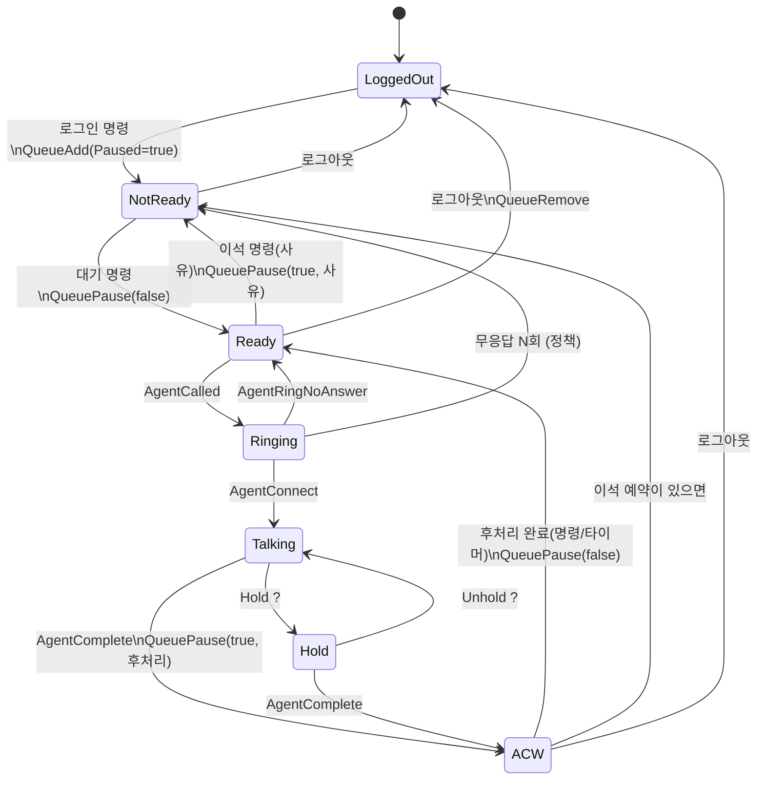

# 06. 상태 모델 — 콜 · 상담원 · 큐 (Stage 2 설계 초안)

> **상태: 초안.** ✓ 표시는 이 환경의 녹화로 확인한 것이고, **?** 표시는 아직 녹화로 확인하지 않은 가설이다.
> Stage 2를 시작하면 시나리오별 녹화를 먼저 만들고, 확인한 사실로 이 문서를 고친 뒤 구현한다.

## 1. 목표와 범위

AMI 이벤트(05 문서)와 상담원의 명령(대기·이석 버튼 등)을 받아서 다음을 **정확하게** 유지한다.

- 지금 어떤 콜이 있고, 각 콜이 어디까지 왔는가 (ARS / 대기 / 벨 / 통화 / 보류 / 종료)
- 상담원마다 지금 무엇을 하고 있고, 그 상태가 언제부터인가
- 큐마다 누가 몇 초째 기다리고 있는가

범위 밖: 화면 표시(Stage 3), 이력 저장과 통계(Stage 4). 상태머신은 이들에게 **변화 알림**만 내보낸다.

## 2. 핵심 아이디어: 순수한 코어 + 얇은 껍데기

```go
// 코어: I/O가 없다. 같은 입력이면 항상 같은 출력.
func Apply(s *State, in Input, now time.Time) []Effect

// 입력: AMI 이벤트, 연결 상태 변화, 상담원 명령, 타이머 만료, 스냅샷 결과
// 효과: AMI 액션 보내기, 타이머 걸기, 상태 변화 발행, 이력 기록 요청
```

```text
ami.Client.Events() ─┐
상담원 명령 (API)  ───┼──▶ 입력 채널 ──▶ [상태 고루틴: Apply 반복] ──▶ 효과 ──▶ AMI 액션 (별도 고루틴)
타이머 만료        ───┤                                          ├──▶ 변화 발행 (Redis, Stage 3)
AMI 액션 결과      ───┘                                          └──▶ 이력 기록 (워커, Stage 4)
```

- 상태는 **고루틴 하나만** 만진다(액터 패턴). 락이 필요 없고 입력 순서가 곧 처리 순서다.
- 효과 실행(네트워크, DB)은 껍데기가 비동기로 한다. 결과(예: QueuePause 실패)는 다시 입력으로 돌아온다.
- 코어가 순수하면 **녹화 replay만으로 테스트**할 수 있고, Rust 구현과 Go 구현의 출력을 바로 비교할 수 있다 (07 문서).
- 시간은 코어가 직접 읽지 않는다. 이벤트는 AMI `Timestamp`를, 명령·타이머는 껍데기가 넘긴 `now`를 쓴다.

## 3. 모델

```text
Channel   uniqueid, linkedid, name, state, callerNum, callerName, connectedNum,
          context, exten, bridgeID, createdAt, answeredAt, hungupAt, cause
Call      id(= linkedid), channels[], direction, customerNum, queue, agent,
          enteredAt, queuedAt, alertingAt, connectedAt, endedAt, outcome
Agent     id, interface(PJSIP/1001), name, state, reason, since,
          currentCall, missedCount, reservedNotReady(이석 예약)
Queue     name, waiting[](callID, position, joinedAt), members[]
```

- **콜 ID = Linkedid.** ✓ 샘플 녹화에서 고객 Local 채널 쌍과 큐가 만든 상담원 채널 쌍이 모두 같은 Linkedid였다.
  전환·Originate에서도 유지되는지는 **?** (녹화로 확인할 것)
- 고객 번호는 `Newchannel`이 아니라 `NewCallerid` 뒤에 확정된다 ✓ (05 문서 6절).

## 4. 상담원 상태머신



전이표 (엔진이 할 일 = 코어가 내보내는 효과):

| 현재 | 입력 | 다음 | 엔진이 할 일 | 확인 |
|---|---|---|---|---|
| LoggedOut | 명령: 로그인 | NotReady(로그인) | `QueueAdd` Paused=true | ✓ 액션 |
| NotReady | 명령: 대기 | Ready | `QueuePause` false | ✓ 액션 |
| Ready | 명령: 이석(사유) | NotReady(사유) | `QueuePause` true, Reason=사유 | ✓ |
| Ready | AgentCalled | Ringing | 스크린팝 발행(고객번호) | ✓ |
| Ringing | AgentRingNoAnswer | Ready | 무응답 카운트 +1 | ? |
| Ringing | AgentRingNoAnswer (N회째) | NotReady(무응답) | `QueuePause` true | ? 정책 |
| Ringing | 고객이 벨 중에 끊음 | Ready | — | ? 어떤 이벤트가 오는지 |
| Ringing | AgentConnect | Talking | currentCall 설정 | ✓ |
| Talking | Hold / Unhold | Hold / Talking | — | ? 어느 채널에 이벤트가 오는지 |
| Talking, Hold | AgentComplete (`Interface`로 상담원을 찾는다) | ACW | `QueuePause` true(후처리), ACW 타이머 시작 | ✓ 채널 정보 없이 올 수 있음 |
| ACW | 명령: 후처리 완료 / 타이머 | Ready | `QueuePause` false | |
| ACW | (이석 예약 있음) | NotReady(예약 사유) | `QueuePause` true, Reason=사유 | |
| Ringing, Talking, Hold | 명령: 이석 | (그대로) | 이석 예약만 기록 | 정책 |
| Ready, NotReady, ACW | 명령: 로그아웃 | LoggedOut | `QueueRemove` | ✓ 액션 |
| 모든 상태 | Disconnected | (그대로, '미확인' 표시) | 재접속 후 재동기화 | |

정책으로 정할 것 (설정값):

- 로그인 직후 상태: NotReady(로그인)로 시작해 상담원이 '대기'를 눌러야 콜을 받는 센터가 많다.
- 후처리 시간 상한(예: 30초)과 자동 대기 전환 여부.
- 무응답 몇 회면 자동 이석으로 돌릴지.
- 통화 중에 누른 이석은 **예약**으로 처리한다 (통화를 끊지 않는다).

## 5. 콜 상태와 결과

```text
Entered(ARS·멘트) → Queued(대기) → Alerting(상담원 벨) → Connected(통화) ⇄ Held(보류) → Ended
```

| 결과 | 판단 근거 | 확인 |
|---|---|---|
| 응대완료 — 상담원 종료 | AgentComplete Reason=agent | ✓ |
| 응대완료 — 고객 종료 | AgentComplete Reason=caller | ? |
| 포기 | QueueCallerAbandon | ✓ (HoldTime=4) |
| 큐 타임아웃 | QueueCallerLeave + 연결 없음, queue_log EXITWITHTIMEOUT | ? |
| ARS·멘트 중 종료 | QueueCallerJoin 없이 Hangup | ? |
| 전환 | AgentComplete Reason=transfer, BlindTransfer / AttendedTransfer 이벤트 | ? |

## 6. 이벤트별 처리

| 이벤트 | 처리 | 확인 |
|---|---|---|
| Newchannel | 채널 생성. Linkedid로 콜에 붙인다 (없으면 콜 생성) | ✓ |
| NewCallerid / NewConnectedLine | 채널·콜의 번호 갱신 | ✓ |
| Newstate | 채널 상태 갱신 (Up = 응답) | ✓ |
| QueueCallerJoin | 콜 Queued, 큐 대기열에 추가 | ✓ |
| AgentCalled | 상담원 Ringing, 콜 Alerting | ✓ |
| AgentRingNoAnswer | 상담원 무응답 처리 | ? |
| AgentConnect | 상담원 Talking, 콜 Connected | ✓ |
| QueueCallerLeave | 대기열에서 제거 (연결·포기·타임아웃 모두에서 온다) | ✓ |
| QueueCallerAbandon | 콜 결과 = 포기 | ✓ |
| AgentComplete | 상담원 ACW, 콜 결과 = 응대완료(Reason). **상담원(`Interface`)으로 찾고, 콜은 그 상담원의 currentCall로 찾는다** — 채널 정보(`Linkedid` 등)가 빠진 채 올 수 있다 | ✓ (e2e로 재현) |
| Hold / Unhold | 보류 / 해제 | ? |
| BlindTransfer / AttendedTransfer | 콜 전환 처리 | ? |
| BridgeEnter / BridgeLeave | 브리지 구성 갱신 (3명 이상이면 회의) | ✓ (2자) |
| Hangup | 채널 종료. 콜의 마지막 채널이면 콜 종료 | ✓ |
| QueueMemberAdded / Removed / Pause | 엔진이 기대한 Asterisk 상태와 비교 (불일치면 경고·보정) | ✓ |
| DeviceStateChange | 무시 (나중에 단말 장애 감지에 쓸 수 있음) | ✓ |

**처리 순서에 기대지 않는다.** AgentComplete는 상담원·고객 채널의 Hangup보다 늦게 올 수 있고 ✓ (05 문서 5절),
그렇게 늦게 오면 채널 정보 없이 올 수도 있다 ✓ (05 문서 6절 11번).
**재동기화 코드는 필드 이름에 주의한다.** 스냅샷의 `QueueMember`는 `Name`·`Location`, 이벤트는 `MemberName`·`Interface`다 ✓.
"채널 Hangup → 통화 끝"과 "AgentComplete → 후처리 시작"을 따로 처리하고, 둘 중 무엇이 먼저 와도 결과가 같게 만든다.

## 7. 재동기화

`Connected`(재접속 포함)를 받으면:

1. `CoreShowChannels`, `QueueStatus` 스냅샷을 받는다 (05 문서 7절).
2. **채널**: 메모리에는 있는데 스냅샷에 없으면 → 끊긴 동안 끝난 것. 종료 처리하고 결과는 "재접속 중 종료"로 둔다.
   스냅샷에만 있으면 → 끊긴 동안 생긴 것. 스냅샷 필드(Linkedid, CallerID, BridgeId)로 만든다.
3. **상담원**: 엔진이 기준이다.
   - 엔진은 로그인으로 아는데 큐 멤버가 아니다 (Asterisk 재시작 ✓ 실측) → `QueueAdd` 다시
   - Paused 값이 엔진 상태와 다르다 → 엔진 상태대로 `QueuePause` 다시
   - 엔진이 모르는 멤버가 있다 → 정책 (제거하고 크게 경고)
   - 엔진은 Talking인데 해당 채널이 없다 → AgentComplete를 놓친 것. ACW로 보낸다
4. 보정할 때마다 로그와 메트릭(`resync_corrections`)을 남긴다. 보정이 잦으면 이벤트 처리에 버그가 있다는 신호다.

## 8. 불변조건

테스트에서 **입력 하나를 처리할 때마다** 검사한다. 하나라도 깨지면 그 입력이 버그를 일으킨 지점이다.

- 상담원의 활성 콜은 최대 1개 (회의 제외)
- Talking·Hold 상담원은 currentCall이 있고, 그 콜은 Connected 또는 Held다
- Ready·NotReady·ACW·LoggedOut 상담원에게는 currentCall이 없다
- 큐 대기열의 콜은 Queued 상태다
- 종료된 콜의 채널은 모두 Hangup 되었다
- 상태 시각(since)은 거꾸로 가지 않는다

## 9. 경쟁 상황 (race) — 녹화로 확인할 가설

1. **후처리 진입 직후 다음 콜이 울리는 문제 ?**
   AgentComplete 직후 엔진의 `QueuePause`가 Asterisk에 닿기 전(수 ms)에, 큐가 같은 상담원에게 다음 고객을 줄 수 있다.
   재현: 상담원 1명 + 대기 고객 여러 명으로 sim → AgentComplete와 다음 AgentCalled 사이 간격과 QueuePause 시점 비교.
   대책 후보: `queues.conf`의 `wrapuptime`을 1~2초로 둬서 엔진의 QueuePause가 도착할 시간을 번다.
2. **이석 버튼과 AgentCalled가 동시에 ?** 이석을 눌렀는데 벨이 울리기 시작했다면 → 이석 예약으로 처리.
3. **재접속 중 상담원 명령**: 연결이 없으면 `ErrNotConnected`. 거부하고 화면에 알릴지, 모아 뒀다 재접속 후 보낼지 정한다.

## 10. 테스트: golden replay

```text
engine/state/testdata/
  normal.ami            AMI 녹화 원본 (번호는 가림)
  normal.cmds.jsonl     상담원 명령 (시각과 함께, 없으면 생략)
  normal.golden.jsonl   기대 출력: 상태 변화 한 줄씩 + 마지막 스냅샷
```

출력 한 줄 예 (키 순서·시간 형식을 고정해야 Rust와 Go를 비교할 수 있다. 07 문서 4절):

```json
{"t":"1792123140.217421","kind":"agent","id":"SIM-1001","from":"Ready","to":"Ringing","call":"1792123138.0"}
```

`go test ./state -run Golden -update`로 기대 출력을 갱신하고, 갱신된 diff는 반드시 눈으로 검토한다.

## 11. 구현 순서 제안

1. 채널·콜 추적 (Newchannel ~ Hangup) + 샘플 녹화 golden test
2. 큐 대기열 (Join / Leave / Abandon)
3. 상담원 상태 (AgentCalled / Connect / Complete) + 명령 (로그인 / 대기 / 이석)
4. 효과 실행 껍데기: QueuePause, ACW 타이머
5. 재동기화
6. 보류·전환·3자통화 — 녹화부터 만들고 시작
